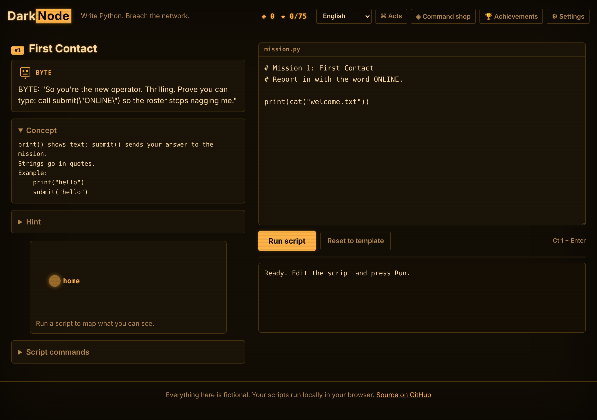
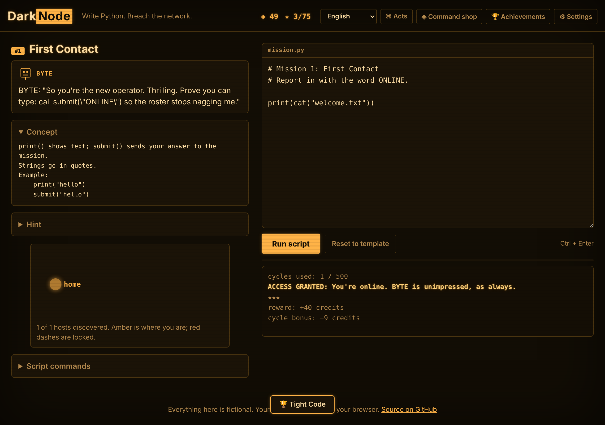
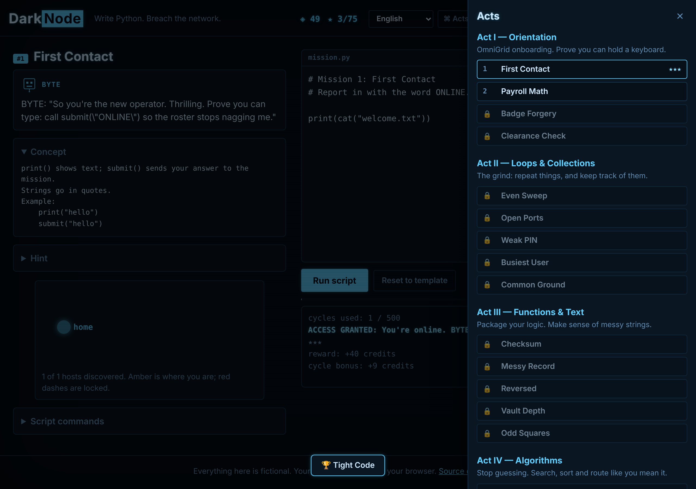
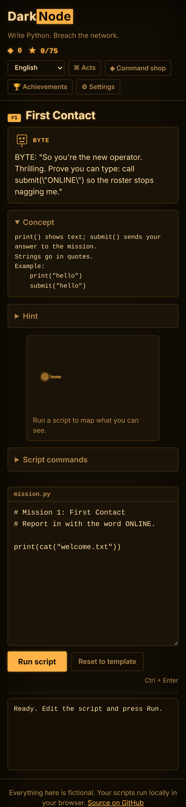

# DarkNode

[](https://github.com/Shoukezz/darknode/actions/workflows/tests.yml)

**[▶ Play in your browser](https://shoukezz.github.io/darknode/)** — phone, tablet or desktop. Nothing to install.

DarkNode is a hacking-themed game that teaches **Python from zero to an advanced level**.
You play a freelance operator poking at the networks of **OmniGrid Dynamics**, an absurd
bureaucratic mega-corporation, under the "guidance" of **BYTE**, a sarcastic AI mentor who
would rather be doing anything else. You can't click your way through — every mission is a
small Python problem. You write a script that scans, cracks, routes and decrypts, and the
game runs it under a limited CPU budget. Clumsy code runs out of cycles; clever code gets in.

> Everything in DarkNode is fictional. The "network" is a graph inside the game, and no real
> systems are touched. All companies, characters and products are invented.



## Highlights

- **25 missions across 5 acts**, one new concept each — from `print` and variables all the
  way to BFS/DFS, Dijkstra, Caesar/Vigenère/XOR/base64 ciphers, toy password hashing and
  log parsing.
- **Learn by doing.** Each mission has a short concept card with a worked example, and
  **three-level hints** (nudge → direction → almost-there). The game *never* shows a full
  solution — reference solutions live only in the test suite.
- **Clever beats brute force.** A CPU-cycle budget makes the naive approach fail and rewards
  tight code with bonus credits, stars and achievements.
- **Two languages.** English and Українська, switchable live. Every string lives in shared
  translation files used by both the web and terminal versions.
- **Retro CRT atmosphere** with humour: phosphor glow, scanlines, screen curvature and a
  boot flicker — all switchable and respecting `prefers-reduced-motion`. Four skins: amber,
  green phosphor, ice-blue and corporate beige.
- **Procedural audio** — synthwave/chiptune music and sound effects synthesized in the
  browser (no audio files), with separate music/SFX volumes.
- **Progression**: credits, a shop of helper commands, achievements, personal best cycles,
  and a **free-play sandbox** of randomly-generated networks after the campaign.
- **Runs anywhere**: a PWA you can install and play offline in the browser, or the exact
  same game in a terminal with no dependencies (Python 3.10+).

| Amber + solved | Ice skin + progression | Mobile |
|---|---|---|
|  |  |  |

## Play

**In the browser:** open [shoukezz.github.io/darknode](https://shoukezz.github.io/darknode/).
The real Python engine runs inside the page through [Pyodide](https://pyodide.org), so your
scripts behave exactly as they do in the terminal version. Progress saves in your browser,
and you can export/import your save as a file to move between devices.

**In a terminal** (Windows, macOS, Linux; Python 3.10+, no dependencies):

```bash
git clone https://github.com/Shoukezz/darknode.git
cd darknode
python -m darknode
```

Or install it as a command:

```bash
pip install -e .
darknode
```

## How to play

```
darknode> missions        # list missions, acts and your stars
darknode> brief 1         # briefing + concept card + hints for mission 1
darknode> new 1           # create scripts/mission1.py from a template
                          # ...edit the script in your editor...
darknode> run 1           # run it against the mission
darknode> lang uk         # switch to Ukrainian
darknode> shop            # spend credits on helper commands
darknode> sandbox 7       # free play on a random network (after the campaign)
```

Inside your script you can call:

| Function | What it does |
|---|---|
| `whoami()` | current host |
| `scan(host=None)` | hosts linked to `host` (default: current host) |
| `links(host=None)` | `(host, latency)` pairs, for routing |
| `connect(host)` | move to an unlocked host you've discovered |
| `hint(host)` | password hint of a locked host |
| `crack(host, password)` | `True` if the password is right; unlocks the host |
| `ls()` / `cat(name)` | list and read files on the current host |
| `size()` / `at(i)` | length and elements of a mission dataset (search missions) |
| `submit(answer)` | send your answer |

Allowed imports: `math`, `string`, `itertools`, `collections`, `functools`, `heapq`,
`base64`, `re`, `bisect`, `textwrap`, `json`, `hashlib`.

## Curriculum

| Act | Theme | What you practise |
|---|---|---|
| I | Orientation | `print`, variables, arithmetic, f-strings, booleans & `if` |
| II | Loops & Collections | `for`/`range`, lists, nested loops & search-space narrowing, dicts, sets |
| III | Functions & Text | functions, string methods, slicing, recursion + memoization, comprehensions |
| IV | Algorithms | sorting with keys, binary search, BFS, DFS/path-finding, Dijkstra shortest path |
| V | Ciphers & Forensics | Caesar, Vigenère, XOR+base64, toy password hashing, regex log parsing, a capstone |

Three missions are built around a trap: the obvious brute force blows the CPU budget (binary
search), recomputes itself to death (naive recursion), or trips an alarm (trying every PIN).
The intended algorithm fits comfortably — the test suite asserts both.

## Architecture

```
darknode/                one engine, shared by both front-ends
  network.py             fictional network: nodes, weighted links, locked hosts
  game.py                GameSession: the API player scripts call
  sandbox.py             runs player code with limited builtins + a cycle budget
  missions.py            mission mechanics: networks, datasets, answer checks
  content.py             acts, achievements, unlock rules
  i18n.py                translation loader + completeness check
  save.py                progress/credits/achievements/best-scores; export/import
  progress.py            award/shop/unlock rules (used by web and terminal alike)
  shop.py                buyable helper commands
  sandbox_gen.py         random network generator for free play
  runner.py              plays a script against a mission -> structured result
  terminal.py            the interactive, language-aware shell
  locales/en.json,uk.json  all player-facing text
web/
  index.html style.css   CRT theme, 4 skins, responsive layout
  app.js                 loads the engine into Pyodide; UI, skins, PWA, save
  audio.js               procedural synthwave/chiptune + SFX (Web Audio)
  bridge.py              JSON bridge between the page and the engine
  manifest.webmanifest sw.js icon.svg   PWA shell
```

The browser and terminal run the **same** Python engine. All game rules (credits, stars,
shop, achievements, unlocks) live in `progress.py`; the browser calls it through Pyodide, so
the two versions can never drift apart. A GitHub Actions workflow copies `web/` and the
engine (including `locales/`) into a static site and publishes it to GitHub Pages.

The sandbox compiles the player's script, runs it with a reduced set of builtins and an
import allow-list, and counts every executed line through `sys.settrace`. When the count
passes the mission's budget, the run stops with "out of CPU cycles". The sandbox is a
**game mechanic, not a security boundary**: it keeps honest scripts inside the rules but is
not meant to contain hostile code.

## Development

```bash
python -m unittest          # 41 tests, no dependencies
```

CI runs the suite on Windows, macOS and Linux with Python 3.10 and 3.13. The tests cover the
engine and sandbox, a reference solution for **every** mission (proving each is solvable in
budget), that every template runs and does *not* solve in both languages, the brute-force
traps, translation completeness (no missing keys), the save round-trip, progression, the shop
and the free-play generator.

To run the web version locally, serve the repository root and open `/web/`:

```bash
python -m http.server
# then open http://localhost:8000/web/
```

## Offline & install (PWA)

The site ships a web app manifest and a service worker. Install it from your browser
("Add to Home Screen" / "Install app") and it runs offline: the app shell, engine and
translations are precached, and the Python runtime is cached on first online load.

## Deploying to GitHub Pages

The `pages.yml` workflow deploys on every push to `main`. The first deploy needs the repo
owner to enable Pages once: **Settings → Pages → Build and deployment → Source: "GitHub
Actions"**. After that the workflow runs on its own. (The one-time "Resource not accessible
by integration" on the very first deploy is this setting not yet being on; it self-heals once
enabled.)

## Roadmap

- [x] Core engine, sandbox, cross-platform CI
- [x] 25-mission campaign in 5 acts (basics → algorithms → ciphers)
- [x] English/Ukrainian, three-level hints, concept cards
- [x] Save, credits, shop, achievements, personal bests
- [x] Browser version: CRT skins, procedural audio, PWA, free-play sandbox
- [ ] More cipher/forensics missions and a daily-seed challenge
- [ ] Optional leaderboards (opt-in, privacy-preserving)

## License

MIT — see [LICENSE](LICENSE).
